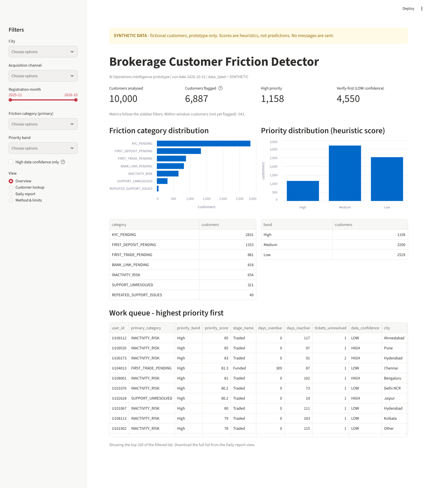

# Brokerage Customer Friction Detector - AI Operations Intelligence

> **ALL DATA IS SYNTHETIC.** Ten thousand fictional customers of a fictional Indian retail brokerage (Nov 2025 - Oct 2026, INR).
> No real customer, brokerage or platform data is used. This is a **portfolio prototype, not a production system**.
> The priority score is a **transparent heuristic, not a machine-learning probability**.
> The tool **sends no messages** and cannot start trades, deposits or withdrawals.

Part of the *Fintech Brokerage Customer Intelligence & Growth Analytics* portfolio project (see the [repository README](../README.md)). It finds customers who are stuck in the onboarding and trading
journey, explains why, ranks them for operations teams, and produces a daily exception report.



## What it does

| Need | Where |
|---|---|
| Detect registered-no-KYC, KYC-no-bank, bank-no-deposit, deposit-no-trade, post-first-trade inactivity, repeated tickets, unresolved/escalated tickets | `friction_detector/engine.py` |
| Avoid flagging new customers too early | windows = 95th percentile of observed completion lags (KYC 11 d, bank 7 d, deposit 14 d, trade 11 d); customers inside the window are `WITHIN_WINDOW` |
| Transparent priority score (0-100), separate from the category | `friction_detector/scoring.py`, `docs/RULES_AND_SCORING.md` |
| AI-assisted insight: category summary, reason, intervention, daily summary | `friction_detector/insights.py` (rule-based; optional LLM re-wording) |
| Dashboard with filters, ID search, journey, intervention, tickets, daily report | `app/streamlit_app.py` |
| Daily workflow: newly flagged, exception CSV, grouped by category | `friction_detector/reports.py`, `cli.py` |
| SQL database | `db/friction.db` (build with the CLI), `sql/schema.sql`, `sql/example_queries.sql` |
| Tests and validation | `tests/` (64 tests), `validation/validate.py` (46 checks), `docs/TESTING.md` |

## Headline results on the synthetic data (31 Oct 2026 run)

* 10,000 customers analysed, **6,887 flagged (68.9%)**; 543 deliberately **not** flagged because they are still inside the normal window.
* Primary category: KYC_PENDING 2,831; FIRST_DEPOSIT_PENDING 1,333; FIRST_TRADE_PENDING 881; BANK_LINK_PENDING 818; INACTIVITY_RISK 654; SUPPORT_UNRESOLVED 321; REPEATED_SUPPORT_ISSUES 49.
* Priority bands among flagged: High 1,158; Medium 3,200; Low 2,529.
* 42 newly flagged versus the previous day's stored run.
* **4,550 flagged customers (66%) are marked data confidence LOW**: the monthly activity log contradicts the funnel record. They need verification in the source system before any outreach.
* The engine agrees with an independent plain-Python re-implementation of the rules for all 10,000 customers (0 false positives, 0 false negatives against the written rules).

## Run it (macOS Apple Silicon, also Linux)

Requires Python 3.10 or newer (built and tested on 3.13). Check with `python3 --version`; if needed `brew install python@3.12`.

```bash
cd fintech-customer-intelligence-analytics/08_ai_friction_detector

python3 -m venv .venv
source .venv/bin/activate
python -m pip install --upgrade pip
python -m pip install -r requirements.txt

# 1. build the SQLite database from the synthetic CSVs
python -m friction_detector.cli build-db

# 2. run eight consecutive daily runs (24-31 Oct 2026) so "newly flagged" has history
python -m friction_detector.cli replay --start 2026-10-24 --end 2026-10-31

# 3. open the dashboard (http://localhost:8501)
streamlit run app/streamlit_app.py
```

Or all in one: `bash scripts/setup_and_run.sh` (set-up, build, replay, tests, validation, then the dashboard; add `--no-app` to skip the dashboard).

Other commands:

```bash
python -m friction_detector.cli run-daily --as-of 2026-10-31     # one day; writes outputs/daily_reports/2026-10-31/
python -m pytest -q                                              # 64 tests
python validation/validate.py                                    # 46 end-to-end checks
sqlite3 db/friction.db < sql/example_queries.sql                 # sample queries (macOS ships with sqlite3)
```

To run daily on a Mac (example, not installed by this project): add to `crontab -e`
`5 7 * * * cd /path/to/fintech-customer-intelligence-analytics/08_ai_friction_detector && .venv/bin/python -m friction_detector.cli run-daily --as-of $(date +\%F)`
(the synthetic data ends on 2026-10-31, so a real date after that returns the same population).

I built and tested this on Linux x86-64 (Python 3.13). I have **not** run it on an Apple Silicon Mac; every dependency has arm64 wheels
and the commands are standard, but treat the Mac run as untested until you try it.

## Outputs

`outputs/daily_reports/2026-10-31/` (sample run, committed):

* `exception_report.csv` - every flagged customer, highest priority first (`data_label = SYNTHETIC`, `score_type` column on every row)
* `newly_flagged.csv`, `by_category/<CATEGORY>.csv`, `summary_by_category.csv`
* `daily_summary.md` - the daily operational summary
* `run_manifest.json` - run metadata and the "no messages sent" statement

## Optional LLM

Off by default. Set `ANTHROPIC_API_KEY` (and optionally `FRICTION_LLM_MODEL`) to let an LLM re-word the summaries.
Only bucketed, de-identified fields are sent (no user ID, city, channel, dates or amounts; small counts suppressed); if the call fails the rule-based
text is used. `FRICTION_DISABLE_LLM=1` switches it off. **The live API call has not been tested** - only the payload guard, the fallback and a mocked
transport. Use `--llm` with `run-daily`, or the checkbox on the customer page.

## Limitations (read before showing this to anyone)

1. **Synthetic data, one snapshot.** Nothing here shows the rules work on real customers. It shows the logic is consistent and testable.
2. **The window backtest is flattering by construction.** In this dataset the 95th-percentile window equals the maximum observed lag, so "0% flagged early" and "no flagged customer ever recovers" are artefacts of the generator.
3. **The score is a heuristic.** Weights are judgement calls, not fitted. No ML is used on purpose: there are no outcome labels (see `docs/RULES_AND_SCORING.md`).
4. **68.9% flagged is too many to work at once.** The point of the score is ordering; a real team would work the top N a day. Capacity and threshold tuning would need real data.
5. **66% of flagged customers have conflicting source data** (data confidence LOW). This is inherited from Phase 2 and is shown, not hidden.
6. **Inactivity is a proxy** (no activity for more than 30 days), not churn.
7. **Replay is approximate** for inactivity and ticket state; the 24-31 Oct history is a replay, not recorded daily runs.
8. No authentication, access control, audit trail, scheduler, CRM or ticketing integration, or outcome tracking. Not deployed anywhere.

## Version control

This folder is part of the portfolio repository, so it is committed with the rest of the repo (see the root README for the publishing commands).
`db/friction.db` is git-ignored (17 MB, rebuilt in seconds by `build-db`); the synthetic CSVs and the 31 Oct sample report are committed.

## Folder map

```
08_ai_friction_detector/
  app/streamlit_app.py            dashboard
  friction_detector/              config, engine, scoring, insights, db, reports, cli
  sql/schema.sql, example_queries.sql
  data/synthetic/                 users, tickets, monthly_activity (SYNTHETIC)
  db/friction.db                  built by the CLI
  outputs/daily_reports/          sample daily reports
  tests/                          pytest suite
  validation/                     oracle, validate.py, results JSON, backtest CSV
  docs/                           ARCHITECTURE, RULES_AND_SCORING, TESTING, screenshots/
  scripts/                        prepare_synthetic_data.py, setup_and_run.sh
```
