<div align="center">

# Fintech Brokerage Customer Intelligence & Growth Analytics

### Where does a retail brokerage lose new customers, which spend produces real traders, and what should the team do first?


-0B1F3A?style=flat&logo=sqlite&logoColor=white)


**Funnel · Activation · Retention · Campaigns · Segmentation · Support · Growth strategy · AI Friction Detector**

[Findings](#10-executive-kpi-summary) · [Recommendations](#19-recommendations) · [Limitations](#20-findings-and-limitations) · [Reproduce](#21-how-to-reproduce) · [Navigate the repo](#9-repository-navigation)

</div>

> **Read this first.** Every record is **synthetic** (a fictional Indian retail brokerage). This is not real data from Groww, Zerodha, moomoo, Futu or any company, and it is not an official or company project. The data has **no revenue, fee or lifetime-value fields, so no revenue or ROI is calculated**. The experiments are **proposed, not run**. The Power BI work is a **build kit and design mockups, not a finished dashboard**.

---

## 1. Title and subtitle

**Fintech Brokerage Customer Intelligence & Growth Analytics**: an end-to-end analytics case study, from a raw extract to cleaned data, SQL/Python/Excel analysis, a dashboard design, a growth plan and an operations prototype.

## 2. Overview

I took a raw synthetic dataset of 10,000 brokerage customers (Nov 2025 – Oct 2026, INR) and worked it the way an analyst on a growth or customer-operations team would: audit the data, clean it without touching the original, analyse the customer journey, cross-check every headline number in three tools, turn the findings into prioritised actions and experiments, and prototype a tool that gives operations a daily list of stuck customers.

**Roles this project is built to demonstrate:** Fintech Business Analyst · Growth Analyst · Product Operations Analyst · Customer Operations Analyst · Marketing Analyst · Customer Retention Analyst · Data Analyst.

## 3. Business problem

A brokerage that adds thousands of registrations but turns only a minority into funded, trading customers pays to acquire people who never become active. Four questions follow:

1. Where in KYC → bank link → deposit → first trade do customers drop out?
2. Which channels and campaigns acquire *traders*, not just sign-ups, and at what cost?
3. Who stays active, and who goes quiet?
4. How much support demand does onboarding create, and what should be fixed first?

## 4. Why brokerage analytics matters

* Acquisition cost is paid per **registration**, but value only starts at the **first trade**; the gap between them is the business.
* Onboarding is regulated and multi-step (KYC, bank, deposit), so friction compounds at every stage.
* Activity is habitual: customers who trade early tend to keep trading, so early engagement is a leading indicator worth managing.
* Support tickets are the earliest signal that a step is confusing, long before a customer is lost.

## 5. Dataset overview

| Property | Value |
|---|---|
| Nature | **Synthetic** – fictional Indian retail brokerage |
| Customers | 10,000 (9,116 in the "mature" cohort with time to convert) |
| Period / snapshot | Nov 2025 – Oct 2026 / 2026-10-31 |
| Currency | INR |
| Tables | Users · Monthly activity · Support tickets (7,614) · Campaigns (10) |
| Not in the data | Revenue, fees, lifetime value, dated spend, confirmed churn, step-level events |

Details: [`data/README.md`](data/README.md) · [`documentation/data_dictionary.md`](documentation/data_dictionary.md) · [`documentation/data_quality_report.md`](documentation/data_quality_report.md)

## 6. Objectives

* Quantify the onboarding funnel and find the largest leak.
* Compare channels and campaigns on **cost per first trade**, not just CAC.
* Measure retention and engagement with honest definitions (proxies labelled as proxies).
* Segment customers into groups an operations team can act on.
* Turn findings into 15 recommendations, 10 testable experiments and a 30-60-90 plan.
* Prove the numbers: SQL = Python = Excel.

## 7. Tech stack

| Layer | Tools |
|---|---|
| Data cleaning & analysis | Python (pandas, NumPy, SciPy, scikit-learn, matplotlib), Jupyter |
| SQL | SQLite, window functions, CTEs (34 queries) |
| Spreadsheet | Excel (live formulas, pivot tables), openpyxl |
| BI | Power BI design: star schema, DAX (117 measures), Power Query *(kit and mockups only)* |
| Prototype | Streamlit, SQLite, rule engine, pytest (64 tests) |
| Documentation | Markdown, Mermaid |

## 8. Workflow

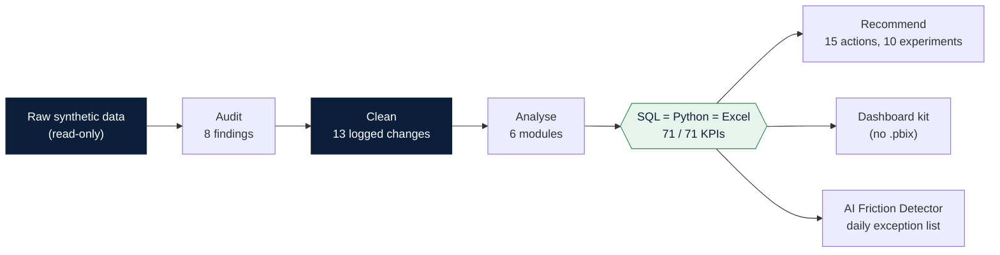

More diagrams (funnel, star schema, detector architecture): [`assets/architecture/architecture.md`](assets/architecture/architecture.md).

## 9. Repository navigation

| Folder | What is inside | Start with |
|---|---|---|
| [`data/`](data/) | Raw (read-only), cleaned, derived tables, data dictionary | [`data/README.md`](data/README.md) |
| [`documentation/`](documentation/) | Overview, methodology, KPI definitions, limitations, data-quality report, verification, recruiter pack | [`project_overview.md`](documentation/project_overview.md) |
| [`01_data_audit/`](01_data_audit/) | Audit scripts and the findings report | [`data_audit_report.md`](01_data_audit/data_audit_report.md) |
| [`02_data_cleaning/`](02_data_cleaning/) | Cleaning script, change log, validation outputs | [`README.md`](02_data_cleaning/README.md) |
| [`03_business_analytics/`](03_business_analytics/) | Acquisition, funnel, retention, segmentation, campaigns, support; Excel workbooks | [`README.md`](03_business_analytics/README.md) |
| [`04_sql/`](04_sql/) | 34 queries, schema, database builder, outputs | [`analysis_queries.sql`](04_sql/analysis_queries.sql) |
| [`05_python/`](05_python/) | Analysis package, pipeline, 5 notebooks | [`README.md`](05_python/README.md) |
| [`06_dashboard/`](06_dashboard/) | Power BI build kit and mockups | [`dashboard_documentation.md`](06_dashboard/dashboard_documentation.md) |
| [`07_growth_strategy/`](07_growth_strategy/) | Recommendations, experiments, 30-60-90 roadmap | [`business_recommendations.md`](07_growth_strategy/business_recommendations.md) |
| [`08_ai_friction_detector/`](08_ai_friction_detector/) | Streamlit prototype with tests | [`README.md`](08_ai_friction_detector/README.md) |
| [`reports/`](reports/) | Final project report, Word report, PDF executive summary | [`final_project_report.md`](reports/final_project_report.md) |
| [`assets/`](assets/) | Charts and architecture diagrams | – |

## 10. Executive KPI summary

*Mature cohort (n = 9,116) unless stated. All synthetic.*

| KPI | Value | Note |
|---|---|---|
| Registered → first trade | **38.0 %** | 3,462 of 9,116 |
| KYC completion | 70.5 % | **42.6 % of all funnel losses** |
| Median time registration → first trade | 23 days | p75 28 days |
| M1 / M3 / M6 retention | 67.6 % / 56.0 % / 40.7 % | calendar-month proxy |
| Monthly active users, Oct 2026 | 4,611 | 46.1 % of 10,000 |
| Dormant for 3 months | 22.0 % | proxy, not churn |
| Paid spend / blended CAC | Rs 2,690,000 / ≈ Rs 331 | recorded spend only |
| Blended cost per first trade (paid) | ≈ Rs 923 | not ROI |
| Support tickets | 7,614 (761 per 1,000 users) | median resolution 9.4 h, CSAT 3.83 |
| Unresolved tickets | 1,371 | 563 older than 90 days |

KPI formulas and denominators: [`documentation/KPI_definitions.md`](documentation/KPI_definitions.md).

## 11. Acquisition funnel

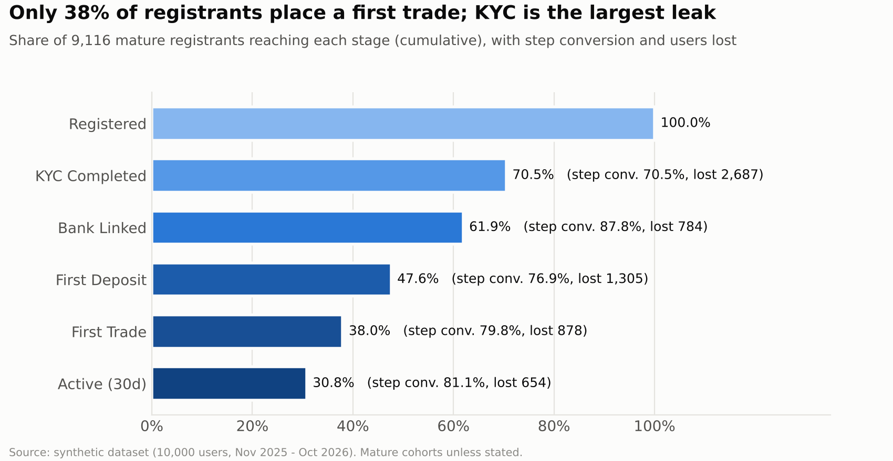

| Stage | Users | Step conversion | Lost |
|---|---|---|---|
| Registered | 9,116 | – | – |
| KYC completed | 6,429 | 70.5 % | **2,687** |
| Bank linked | 5,645 | 87.8 % | 784 |
| First deposit | 4,340 | 76.9 % | 1,305 |
| First trade | 3,462 | 79.8 % | 878 |
| Active (30d) | 2,808 | 81.1 % | 654 |

**KYC is the largest leak; first deposit is second.** Median stage times are KYC 6 days, bank 4, deposit 7, first trade 6, and channels differ by only about 2 days in time to first trade, so the delay does not look channel-driven.

## 12. Activation

Activation is the first trade. Only **38.0 %** of mature registrants get there. Users who traded in their first two months retained better at month 3 (60.7 % vs 50.0 %), which is why the plan builds onboarding around an early first-trade milestone. This is an association: early traders may simply be more motivated customers.

<details>
<summary><b>Activation by acquisition channel (first-trade rate, mature cohort)</b></summary>

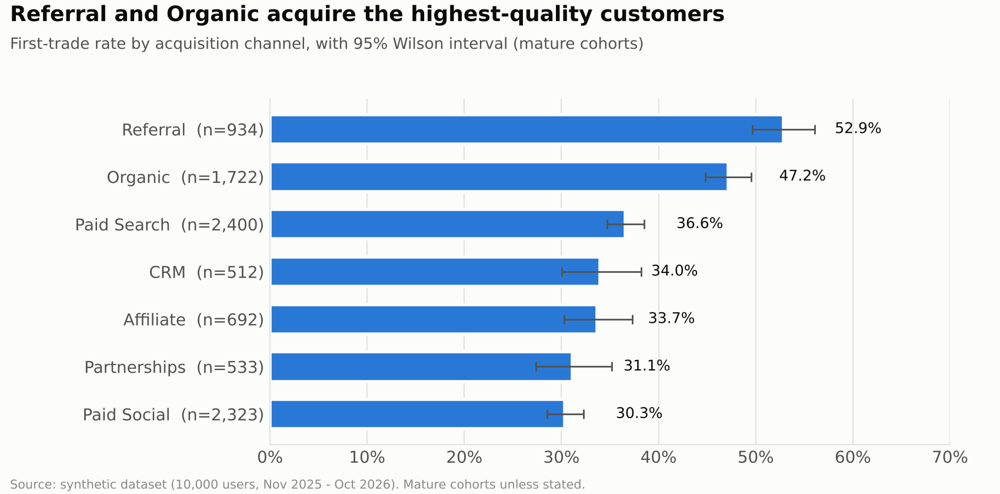

Referral 52.9 % · Organic 47.2 % · Paid Search 36.6 % · CRM 34.0 % · Affiliate 33.7 % · Partnerships 31.1 % · Paid Social 30.3 % (channel differences significant, chi-square p < 0.001).
</details>

## 13. Retention and churn

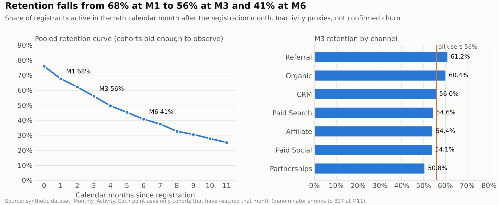

Retention **decays steadily rather than collapsing** after onboarding: M1 67.6 %, M3 56.0 %, M6 40.7 %. Referral and organic cohorts hold up best (M3 about 61 %); partnerships are weakest (50.8 %).

*"Dormant for 3 months" (22.0 %) and "Inactive 90d" (14.9 %) are proxies: the data has no account closures or transfers-out, so it cannot measure confirmed churn.* A logistic early-warning model reached only AUC 0.57, so it is reported as weak and not used.

<details>
<summary><b>Cohort heatmap</b></summary>

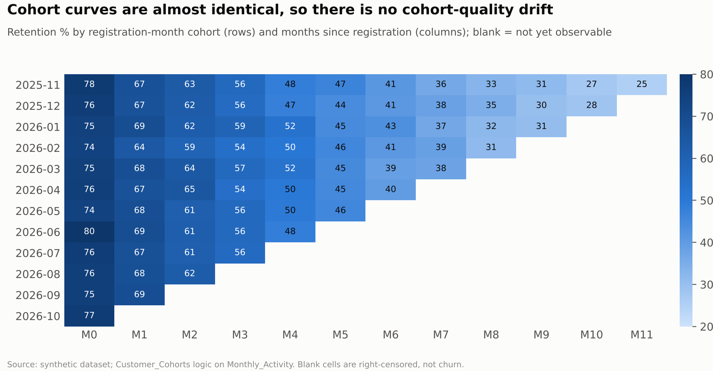
</details>

## 14. Campaign performance

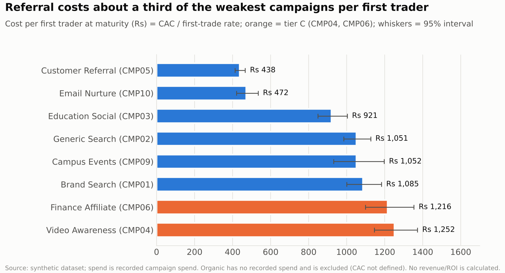

| Campaign | CAC | First-trade rate | Cost per first trade |
|---|---|---|---|
| Customer Referral | Rs 232 | 52.9 % | **Rs 438** |
| Email Nurture (CRM) | Rs 160 | 34.0 % | Rs 472 |
| Education Social | Rs 276 | 30.0 % | Rs 921 |
| Generic Search | Rs 393 | 37.4 % | Rs 1,051 |
| Campus Events | Rs 328 | 31.1 % | Rs 1,052 |
| Brand Search | Rs 385 | 35.5 % | Rs 1,085 |
| Finance Affiliate | Rs 410 | 33.7 % | Rs 1,216 |
| Video Awareness | Rs 385 | 30.8 % | **Rs 1,252** |

CAC alone mis-ranks campaigns: Email Nurture is cheaper than Customer Referral per registration (Rs 160 vs Rs 232), but Referral is cheaper per *trader* (Rs 438 vs Rs 472) because far more of its users trade. Video Awareness is significantly below the other campaigns after Holm correction; Finance Affiliate is not (p = 0.061). Shifting Rs 190,000 from the two weakest to the two strongest paid campaigns would add about 265 first traders **at observed efficiency**, but the gain vanishes if destination costs rise by about 172 %. That is arithmetic, not a forecast.

## 15. Segmentation

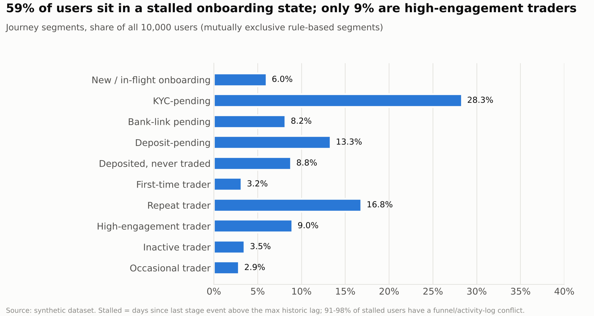

Ten rule-based journey segments (explainable to operations) show that **58.6 % of users are stalled in onboarding**: KYC-pending 28.3 %, deposit-pending 13.3 %, deposited-never-traded 8.8 %, bank-link-pending 8.2 %. High-engagement traders are 9.0 % and repeat traders 16.8 %. K-means found only weakly separated clusters (silhouette 0.33), so the rule-based segments are used for action.

## 16. Customer support

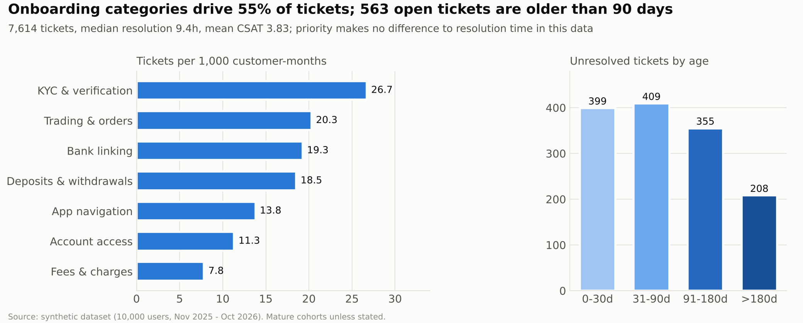

* 7,614 tickets; **52 % of users raised at least one**. KYC and verification is the largest category (22.7 %), then trading and orders (17.2 %).
* Median resolution **9.4 h**, CSAT **3.83**.
* **1,371 unresolved** (892 open, 479 escalated); **563 older than 90 days**, 208 older than 180.
* Priority does not change resolution time (High, Medium and Low all about 9.4–9.5 h; p = 0.59).
* Ticket-raisers are only slightly more likely to go dormant (cohort-adjusted odds ratio 1.15, 95 % CI 1.03–1.30). That is an association, not a cause.

## 17. Dashboard screenshots

> **There is no Power BI `.pbix` and no Power BI screenshot.** Power BI Desktop was not available, so the dashboard was designed and specified but never built or opened. What exists: star-schema data, 117 DAX measures (logic verified against a pandas re-implementation, 231 of 231 comparisons), Power Query, themes and page specifications. The images below are **matplotlib mockups of the intended design**, each labelled as such.

<details>
<summary><b>Design mockups (not Power BI screenshots)</b></summary>

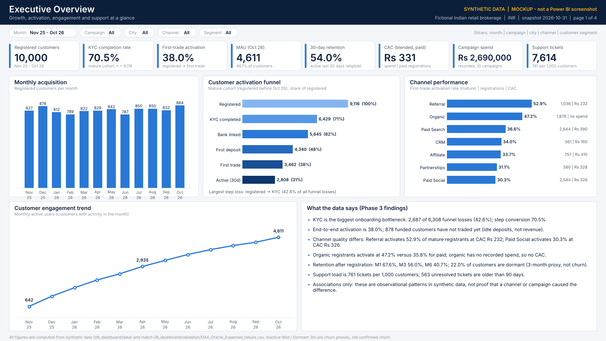
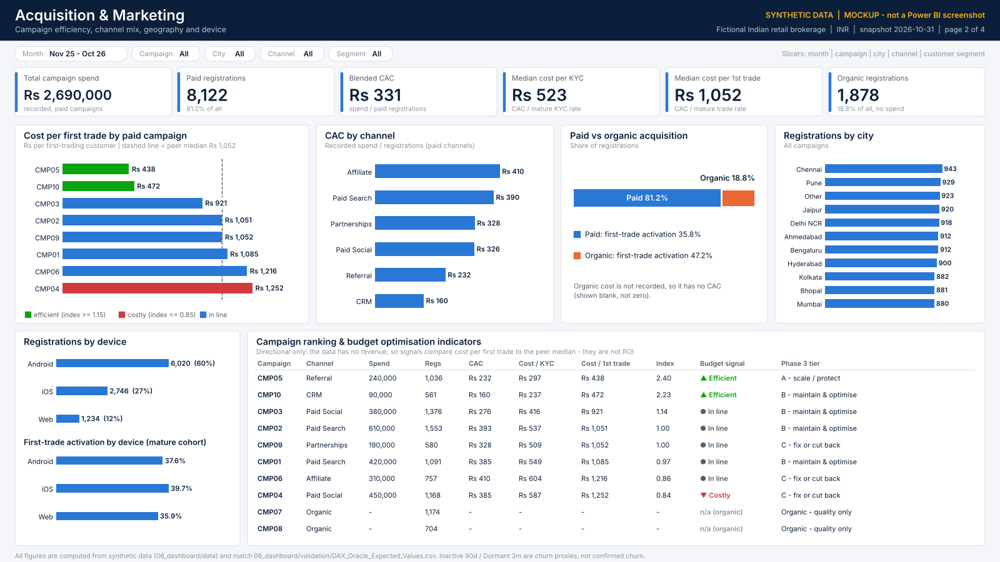
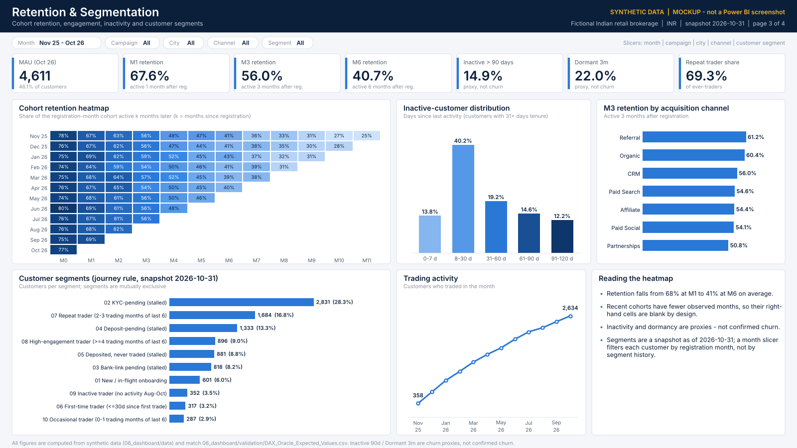
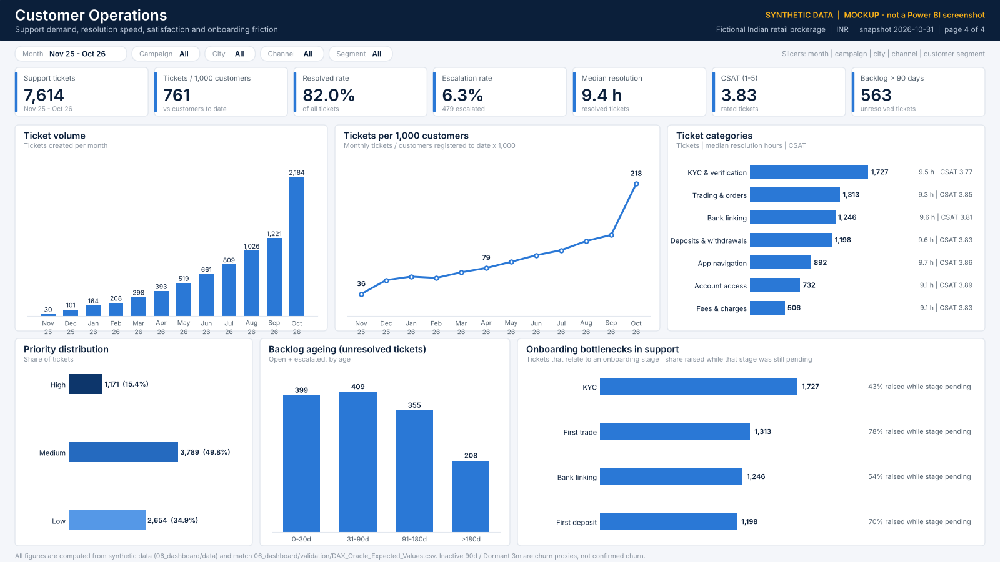
</details>

The seven real screenshots to export once the dashboard is built, and where to save them, are listed in [`06_dashboard/dashboard_documentation.md`](06_dashboard/dashboard_documentation.md#screenshots-to-export-once-the-dashboard-exists).

## 18. AI Friction Detector

A prototype that finds customers stuck in onboarding or going quiet, explains why, ranks them with a transparent 0–100 score, and writes a daily exception report. **The score is a heuristic, not a probability; the tool sends no messages.**

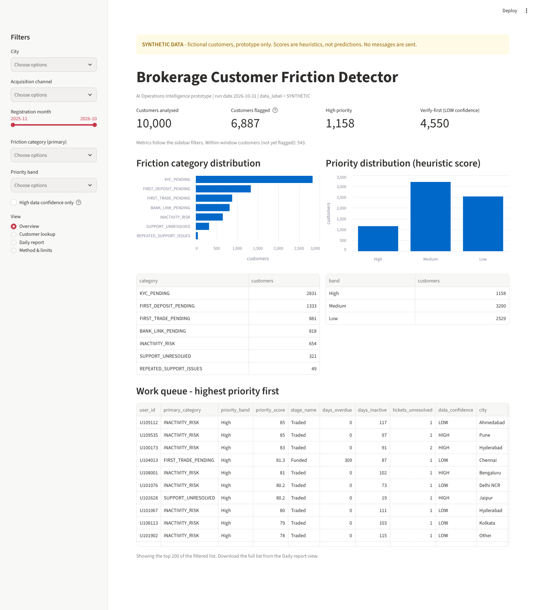

| Result (synthetic run, 31 Oct 2026) | Value |
|---|---|
| Customers analysed / flagged | 10,000 / 6,887 (68.9 %) |
| Deliberately **not** flagged (still inside the normal completion window) | 543 |
| Priority High / Medium / Low | 1,158 / 3,200 / 2,529 |
| Flagged but **low data confidence** (activity log contradicts the funnel record) | 4,550 (66 %) |
| Tests / validation checks | 64 / 46 pass |

Observed-lag windows (KYC 11 days, bank 7, deposit 14, trade 11) stop new customers being flagged too early. The "AI" layer is rule-based explanation text with an optional LLM re-wording step that has **not been exercised against a live model**. Run it: [`08_ai_friction_detector/README.md`](08_ai_friction_detector/README.md).

## 19. Recommendations

Fifteen recommendations in four themes; full detail with evidence, owners, KPIs and risks in [`07_growth_strategy/business_recommendations.md`](07_growth_strategy/business_recommendations.md).

| Priority | Recommendation | Why (evidence) |
|---|---|---|
| P1 | **Fix the KYC step**: checklist, status tracker, assisted KYC | 42.6 % of funnel losses; largest ticket category |
| P1 | **Make cost per first trade the headline campaign KPI** | CAC alone mis-ranks campaigns |
| P1 | **Stage a budget shift** with a break-even rule | Rs 438 vs Rs 1,252 per first trade, but diminishing returns are untested |
| P1 | **Make support priority real; clear the 90-day backlog** | 563 tickets older than 90 days; priority changes nothing today |
| P1 | **Fix the data foundation** (reconcile flags, log step events, date the spend) | Activity log conflicts with funnel record; no ROI is possible without it |
| P2 | Reduce first-deposit hesitation; guide the first trade; early first-trade milestone; value-led win-back with a holdout | Deposit and first trade are the next two leaks |

Ten A/B tests (EXP-01 to EXP-10) are sized with actual baselines and **assumed** effects ([`experiment_design.md`](07_growth_strategy/experiment_design.md)); a 30-60-90 plan sequences everything ([`30_60_90_day_roadmap.md`](07_growth_strategy/30_60_90_day_roadmap.md)). Nothing has been run.

## 20. Findings and limitations

**What the project shows:** the leak is KYC; channel quality differs far more than channel cost; retention decays steadily; support demand sits in onboarding topics; a rule-based approach is more usable here than clustering or prediction.

**What it does not show:**

* No revenue, fees or lifetime value → **no ROI**. Cost per first trade is an efficiency measure, not a return.
* Retention, inactivity and dormancy are **proxies**; confirmed churn is not observable.
* Campaign and channel differences are **observational** (referral may simply attract motivated users).
* The activity log **conflicts with the funnel record** for many users (flagged, not corrected).
* All experiments are **proposed**; lifts are assumptions used only to size tests.
* Synthetic data reflects how it was generated; patterns need not hold in a real business.
* Power BI: kit and mockups only. Built and tested on Linux; not run on macOS.

Full list: [`documentation/limitations.md`](documentation/limitations.md).

## 21. How to reproduce

Python 3.10 or newer. From the repository root:

```bash
python3 -m venv .venv && source .venv/bin/activate
python -m pip install --upgrade pip && python -m pip install -r requirements.txt

python3 02_data_cleaning/01_phase2_clean_validate_transform.py   # raw -> cleaned (raw is never modified)
python3 04_sql/build_database.py && python3 04_sql/run_queries.py # 34 SQL queries
python3 05_python/pipeline/run_pipeline.py                        # Python analysis + KPI report
python3 05_python/pipeline/verify_phase4.py                       # cross-check Python vs SQL vs Excel (71/71)
```

All paths are relative to the repository root, so it runs from any clone location. Per-folder instructions are in each folder's README.

## 22. Installation

```bash
git clone https://github.com/sharma23yash-oss/fintech-customer-intelligence-analytics.git
cd fintech-customer-intelligence-analytics
python3 -m venv .venv && source .venv/bin/activate
python -m pip install -r requirements.txt
```

The AI Friction Detector has its own requirements (`08_ai_friction_detector/requirements.txt`); see its README for the three commands that build the database, replay eight days and open the dashboard. Rebuilding the Excel and Word reports from scratch additionally needs LibreOffice and Node; that is archival and not required.

## 23. Architecture

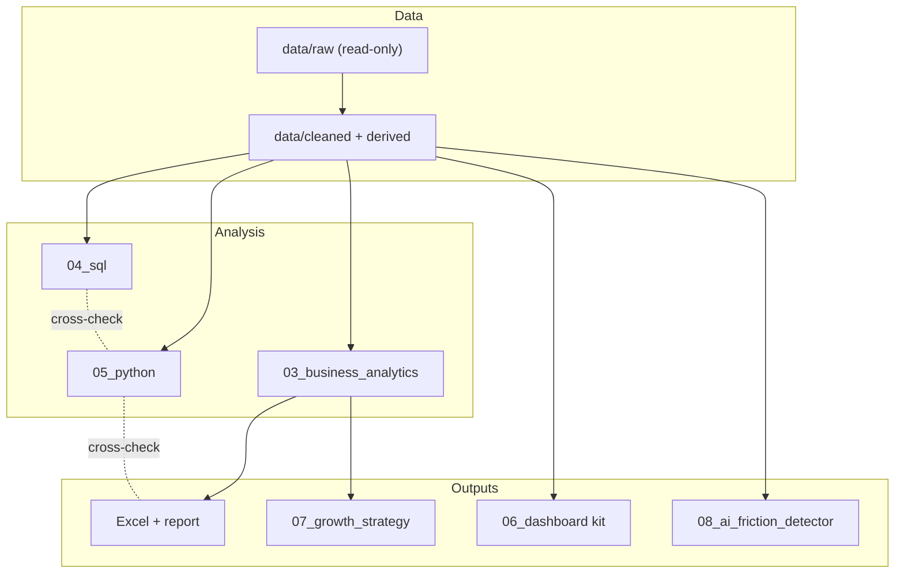

## 24. Future improvements

1. Build the Power BI report from the kit and export real screenshots.
2. Reconcile the activity log with the funnel record and add step-level event logging.
3. Date the marketing spend and capture clicks so budget shifts can be tested properly.
4. Add revenue and fee data so cost per first trade can become a return measure.
5. Run the first experiment (assisted KYC, EXP-02) on a real or simulated traffic split.
6. Exercise the Friction Detector's optional LLM step against a live model, and run the full project on macOS.

## 25. Author

**Yash Sharma** · MBA (Finance & Marketing), MANIT Bhopal

[GitHub](https://github.com/sharma23yash-oss) · [Website](https://yashify.tech) · LinkedIn: *add your profile URL here*

*An independent portfolio project on synthetic data. Not affiliated with any company.*

---

<sub>MIT licence · see [`LICENSE`](LICENSE) · All data synthetic.</sub>
