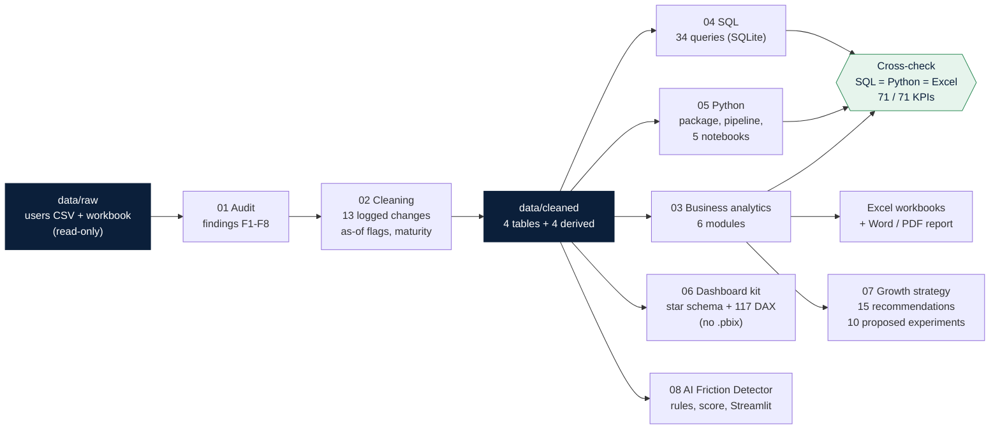
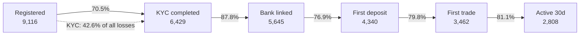
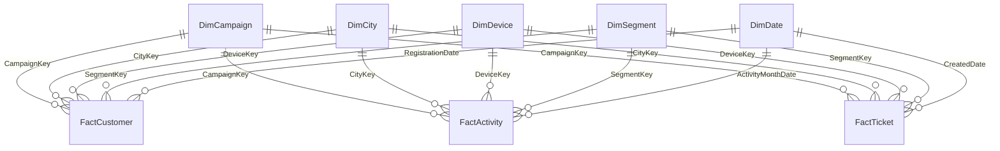
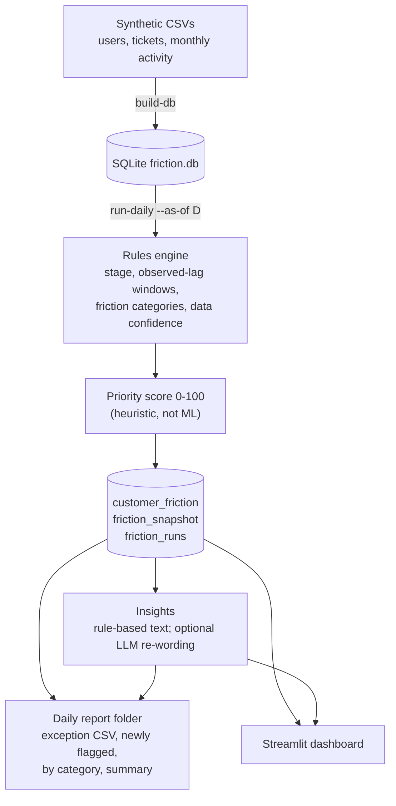
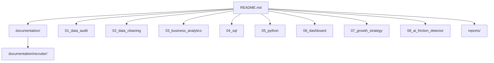

# Architecture diagrams

Diagrams are Mermaid, so GitHub renders them directly. **All data are synthetic.**

## 1. End-to-end workflow

## 2. Customer onboarding funnel (mature cohort, n = 9,116)

## 3. Data model for the dashboard (star schema)

All 15 relationships are one-to-many, single-direction (each fact carries the dimension keys, so there are no fact-to-fact links); `DimStage` is deliberately unrelated. Full table: [`06_dashboard/docs/Data_Model.md`](../../06_dashboard/docs/Data_Model.md).

## 4. AI Friction Detector

Detail: [`08_ai_friction_detector/docs/ARCHITECTURE.md`](../../08_ai_friction_detector/docs/ARCHITECTURE.md).

## 5. Where each deliverable lives

